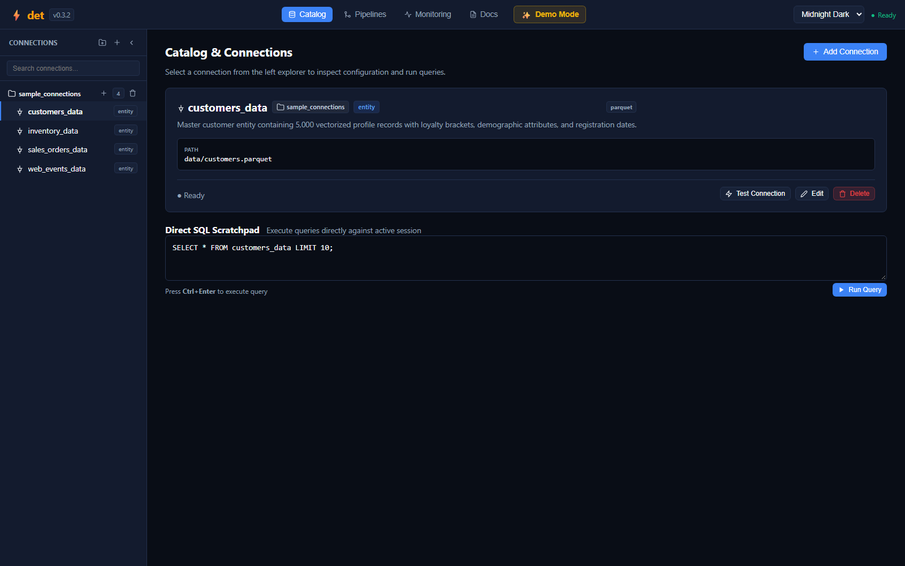

# Web IDE: Catalog & Lakehouse Connections

The **Catalog** module in the `det` Web IDE allows data engineers to visually declare, test, and query connections to databases, multi-cloud storage buckets, and lakehouse tables without writing low-level mounting code.

---

## 🔌 Unified Lakehouse Catalog

`det` unifies diverse data silos into a single declarative namespace. Once configured in the catalog, any table can be queried or joined in your SQL pipeline models using `{{ source('catalog_name') }}`.



### Supported Storage Targets in the GUI

* **Cloud Object Stores**: AWS S3 (`s3://`), Azure Blob & ADLS Gen2 (`abfss://`), Google Cloud Storage (`gs://`).
* **Lakehouse Formats**: Delta Lake (ACID reads and writes), Microsoft Fabric OneLake, Apache Iceberg.
* **Relational Engines**: PostgreSQL, MySQL, SQLite, Microsoft SQL Server.
* **File Formats**: Apache Parquet, Snappy/Zstd Compressed Parquet, CSV, TSV, NDJSON, Excel (`.xlsx`).

---

## ⚡ Connection Health Probe

When you select a connection in the left explorer, the Web IDE displays a detailed connection card:

1. **Path & Protocol Details**: Inspect the target URI, directory layout, or database credentials.
2. **Test Connection Button**: Clicking **Test Connection** instructs the local DuckDB session to:
   * Verify network connectivity to the target endpoint.
   * Authenticate cloud credentials (AWS Secrets, Azure Service Principals, GCS HMAC tokens).
   * Measure latency in milliseconds.
   * Display a green `Ready` pill or an informative error diagnosis if permissions are missing.

---

## 📝 Direct SQL Scratchpad

At the bottom of the Catalog view, the **Direct SQL Scratchpad** provides an instant, interactive SQL console:

```sql
SELECT * FROM customers_data WHERE loyalty_tier = 'PLATINUM' LIMIT 10;
```

* **Zero-Scaffolding Exploration**: Execute ad-hoc queries against mounted catalog sources without creating a pipeline or writing model files.
* **Multi-Format Joins**: Seamlessly join local CSV files with remote S3 Delta Lake tables in a single SQL query.
* **Fast Execution**: Analytical queries run at DuckDB vectorized speeds with automatic parallel thread utilization.
* **Shortcut**: Press `Ctrl + Enter` to execute immediately.

---

## ➕ Adding a Connection Visually

Click the **+ Add Connection** button in the header to open the connection creation dialog:
1. Select the connection type (e.g. `S3`, `Delta Lake`, `PostgreSQL`, `Parquet`).
2. Provide an alias identifier (e.g. `raw_events_lake`).
3. Enter URI path and optional credentials.
4. Click **Save Connection** — the catalog YAML is immediately updated and mounted into your workspace.

---

| ⬅️ Previous Page | 🏠 Overview | Next Page ➡️ |
| :--- | :---: | ---: |
| [**← Web IDE: Data Quality & Quarantine**](Web-IDE-Data-Quality-&-Quarantine) | [**Wiki Index**](Home) | [**Web IDE: Monitoring & Living Documentation ➔**](Web-IDE-Monitoring-&-Living-Documentation) |
