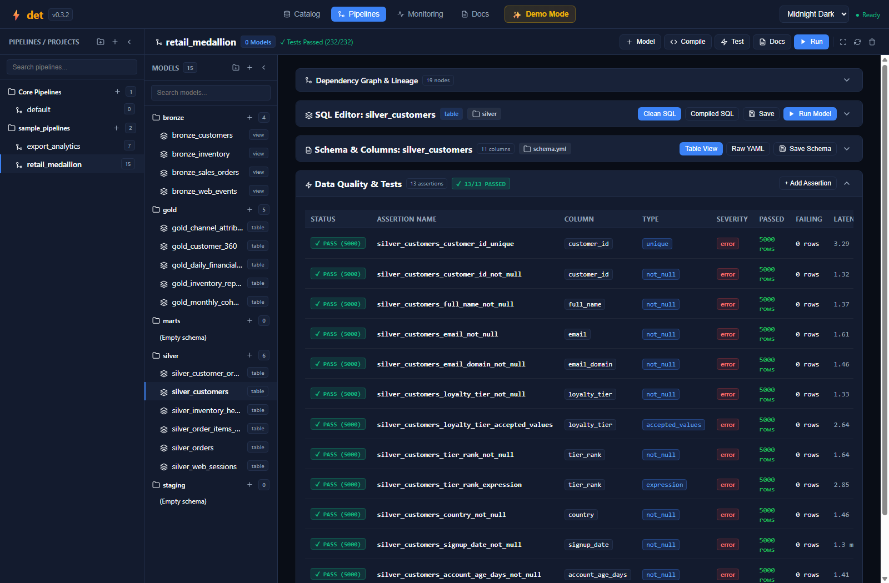

# Web IDE: Data Quality & Policies

Data quality is a first-class citizen in `det`. The Web IDE provides visual controls to author assertion contracts, run automated tests across pipeline stages, and enforce non-bloating data quality policies in real time.

---

## 🛡️ Defining Visual Quality Assertions

Quality checks can be defined at both the column level and the model level directly within the Web IDE or via standard `schema.yml` contracts.



### Built-in Column Assertions

| Assertion | Description | Example Rule |
| :--- | :--- | :--- |
| `not_null` | Asserts column contains zero `NULL` or missing values. | `customer_id` must not be null |
| `unique` | Asserts every value in the column or compound key is unique. | `order_id` uniqueness check |
| `accepted_values` | Validates values belong to a defined whitelist. | `status IN ('PENDING', 'COMPLETED', 'CANCELLED')` |
| `expression` | Arbitrary SQL boolean condition evaluated per row. | `net_amount >= 0.0` or `discount_pct <= 1.0` |
| `relationships` | Validates referential integrity against parent model keys. | `customer_id` references `dim_customers.id` |

---

## 🧪 Interactive Test Execution

Clicking the **Test** button in the pipeline ribbon executes all assertions defined across the DAG:
* **Real-Time Badge Updates**: DAG nodes turn green (`✓ 13 pass`), amber for warnings, or red for errors.
* **Detailed Assertions Table**: Displays assertion name, target column, test type, policy severity, rows passed, rows violating, and execution latency.
* **In-Memory Speed**: Powered by vectorized DuckDB scans, hundreds of assertions execute in single-digit milliseconds.

---

## 🎯 Three Clean Enforcement Policies

In real-world data engineering, handling invalid data requires flexible yet clean strategies that do not bloat UI storage or crash unrelated processing. `det` provides three clean policies:

```
Raw Input Data ──────► [Quality Validation] ───┬──► Clean Rows ──► Silver / Gold Tables
                                               │
                                               └──► Dropped Rows (In-Engine EXCEPT ALL)
```

### 1. `error`
Immediately stops pipeline execution if any row fails validation.
- **Best for**: Strict schema requirements, primary key uniqueness, foreign key relationships, or financial reconciliation models where dirty data cannot be tolerated.

### 2. `warning` (`warn`)
Processes rows normally and logs the aggregate count of violating rows in monitoring telemetry.
- **Best for**: Soft SLAs, trend anomalies, or optional metadata fields.
- **No Log Bloat**: Only records the aggregate count of offending rows rather than persisting thousands of individual row payloads.

### 3. `drop`
Drops the failing rows in-engine using DuckDB's vectorized `EXCEPT ALL` and processes the remaining compliant rows normally.
- **Best for**: Ingestion pipelines where dirty records can be discarded without failing downstream analytics marts.
- **Zero Friction**: Clean rows pass through uninterrupted without requiring manual UI button clicking.

---

### Configuring Policies in YAML

In your model's `schema.yml`, specify the desired `severity` on any test:

```yaml
version: 2
models:
  - name: silver_orders
    columns:
      - name: customer_id
        tests:
          - not_null:
            severity: error
      - name: net_amount
        tests:
          - expression: "net_amount >= 0.0"
            severity: drop
      - name: discount_pct
        tests:
          - expression: "discount_pct <= 0.5"
            severity: warning
```

---

## 🔍 Auditing Policy Violations in Monitoring

In the Web IDE **Monitoring** tab:
* View aggregate counts of tests passed, warned, dropped, and errored per execution.
* Audit stage-by-stage latencies and row volumes.
* Retain full execution history without UI strain or bloated log storage.

---

| ⬅️ Previous Page | 🏠 Overview | Next Page ➡️ |
| :--- | :---: | ---: |
| [**← Web IDE: Pipelines & DAG Studio**](Web-IDE-Pipelines-&-DAG-Studio) | [**Wiki Index**](Home) | [**Web IDE: Catalog & Lakehouse Connections ➔**](Web-IDE-Catalog-&-Lakehouse-Connections) |
