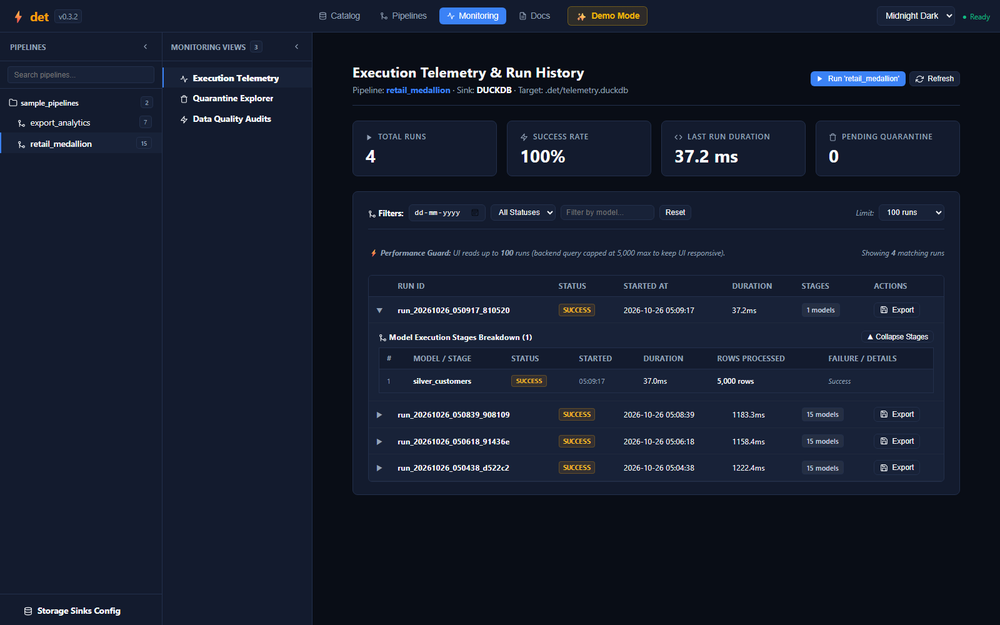
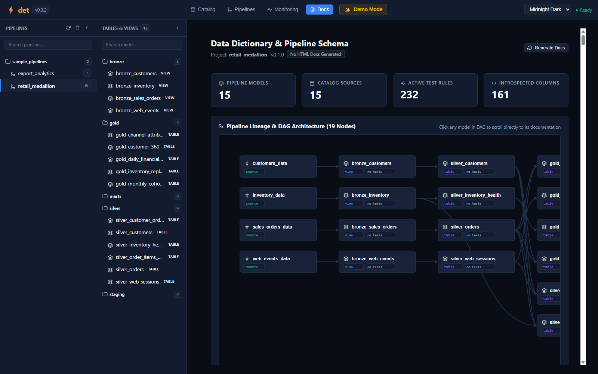

# Web IDE: Monitoring & Living Documentation

Observability and self-documenting data architectures are essential for maintainable analytics engineering. The `det` Web IDE includes dedicated visual modules for execution telemetry tracking and living data dictionaries.

---

## 📊 Execution Telemetry & Run History

Every execution of a `det` pipeline—whether initiated headlessly from CI/CD (`det run`) or visually via the Web IDE—is automatically logged to persistent telemetry sinks.

### Telemetry Dashboard Metrics

* **Execution Overview Cards**:
  * **Total Runs**: Lifetime runs executed in this project workspace.
  * **Success Rate**: Overall percentage of successful pipeline runs (e.g. `100%`).
  * **Last Run Duration**: End-to-end wall-clock time in milliseconds (e.g. `1158.4 ms`).
  * **Pending Quarantine**: Number of non-compliant records quarantined during the last execution.
* **Stage-by-Stage Millisecond Breakdown**:
  * An interactive breakdown table showing each model stage in execution order (e.g. `#1 bronze_customers: 12.1ms, 5,000 rows`, `#3 bronze_sales_orders: 217.8ms, 25,000 rows`).
  * Visual status badges (`SUCCESS` vs `FAILURE`).
  * Processed row counts and throughput rates.
* **Filter Controls**:
  * Filter runs by date range, execution status, or model name.
  * Built-in performance guard caps query depth to ensure the UI remains blazing fast.

### Pluggable Storage Sinks
Telemetry is stored locally in `.det/telemetry.duckdb` by default. You can configure additional sinks (such as flat JSON lines or database targets) via the persistent **Storage Sinks Config** drawer at the bottom of the sidebar.

---

## 📖 Automated Living Data Dictionary

The **Docs** module transforms your pipeline YAML contracts and SQL models into an interactive, visual data catalog with zero external static site generators required.

### Data Dictionary Features

* **Introspected Schema Contracts**:
  * Explore all 160+ columns with their physical DuckDB data types (`BIGINT`, `VARCHAR`, `DOUBLE`, `DATE`).
  * Review column descriptions defined in `schema.yml`.
  * Audit active test assertions attached to each column (`not_null`, `unique`, ranges).
* **Embedded Pipeline Lineage Graph**:
  * An interactive SVG dependency graph reflects upstream and downstream model relationships.
  * Clicking any node in the graph scrolls directly to that model's documentation card.
* **Zero-Build Publishing**:
  * Click the **Generate Docs** button in the header at any time to compile a standalone, self-contained HTML documentation bundle (`det doc`) ready to share with stakeholders or host on GitHub Pages.

---

| ⬅️ Previous Page | 🏠 Overview | Next Page ➡️ |
| :--- | :---: | ---: |
| [**← Web IDE: Catalog & Lakehouse Connections**](Web-IDE-Catalog-&-Lakehouse-Connections) | [**Wiki Index**](Home) | [**CLI & Web IDE Reference ➔**](CLI-&-Web-IDE-Reference) |
