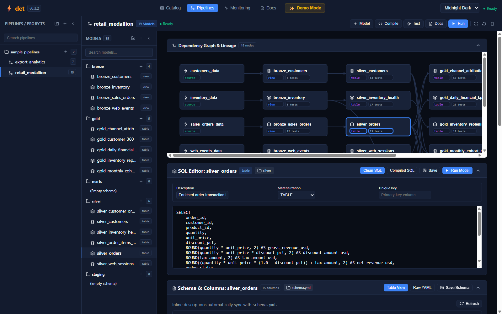
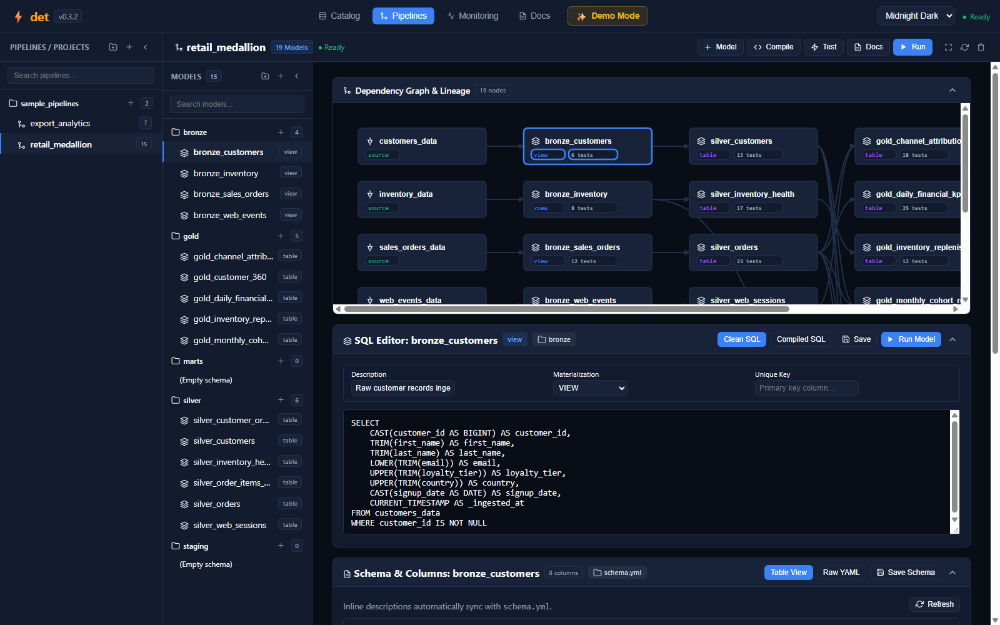

# Web IDE: Pipelines & DAG Studio

The **Pipelines** studio is the central cockpit in the `det` Web IDE for designing, inspecting, testing, and debugging multi-model SQL transformation workflows.

---

## 📊 Interactive DAG Lineage Graph

`det` automatically parses your pipeline SQL queries and constructs a topological Directed Acyclic Graph (DAG) based on your `{{ ref('upstream_model') }}` statements and `{{ source('catalog_item') }}` references.

### Key DAG Capabilities
* **Color-Coded Medallion Architecture**: Nodes visually distinguish raw **Sources** (`customers_data`), **Bronze** staging views (`bronze_customers`), **Silver** cleansed tables (`silver_customers`), and **Gold** analytical marts (`gold_customer_360`).
* **Live Test Status Badges**: Each node displays real-time assertion pass counts (e.g. `✓ 6 pass`, `✓ 13 pass`). Clicking any badge opens the corresponding test audit report.
* **Pan & Zoom Controls**: Drag to pan across wide DAGs, scroll to zoom, or click the **Fit to Canvas** button to automatically re-center large pipelines.
* **Topological Re-ordering**: Upstream models always render to the left of downstream consumers, ensuring transparent data lineage.

---

## 📝 Dual-Mode SQL Model Editor

Selecting any model from the explorer or DAG card loads its code into the built-in SQL editor.

### Clean SQL vs. Compiled SQL View
The editor provides a one-click toggle between two views:
1. **Clean SQL**: Shows your authoring code containing declarative Jinja macros like `{{ ref('stg_orders') }}` and `{{ config(materialized='table') }}`.
2. **Compiled SQL**: Shows the exact, resolved SQL that DuckDB 2.0 executes under the hood, replacing macros with physical table identifiers or views.

### Model Configuration Controls
Directly above the SQL editor, you can configure model-level metadata without manually touching YAML files:
* **Description**: Human-readable purpose of the model (automatically synchronized with `schema.yml` and the documentation portal).
* **Materialization Selector**: Choose between `VIEW`, `TABLE`, `INCREMENTAL`, and `EPHEMERAL`.
* **Unique Key**: Set primary key column(s) for incremental merges and deduplication.

---

## ⚡ Live Single-Model & Pipeline Execution

The Web IDE allows you to execute transformations at multiple levels of granularity:

1. **Run Model (`Ctrl + Enter`)**: Runs only the selected model and its immediate inputs, returning real-time execution duration in milliseconds.
2. **Run Pipeline (Command Ribbon)**: Topologically compiles and runs every model in the active project in dependency order, updating stage status badges in real-time.
3. **Compile Button**: Validates SQL syntax and resolves Jinja references without executing analytical scans on data.

---

## 📋 Schema & Columns Panel

Beneath the SQL editor, the **Schema & Columns** panel displays the output contract of your transformation:

| View Mode | Description |
| :--- | :--- |
| **Table View** | Interactive table listing introspected column names, DuckDB data types (`BIGINT`, `VARCHAR`, `DOUBLE`, `TIMESTAMP`), description editor, and active test badges. |
| **Raw YAML** | Directly view and edit the model's `schema.yml` specification with instant validation and saving. |

---

| ⬅️ Previous Page | 🏠 Overview | Next Page ➡️ |
| :--- | :---: | ---: |
| [**← Web IDE Overview & Getting Started**](Web-IDE-Overview-&-Getting-Started) | [**Wiki Index**](Home) | [**Web IDE: Data Quality & Quarantine ➔**](Web-IDE-Data-Quality-&-Quarantine) |
